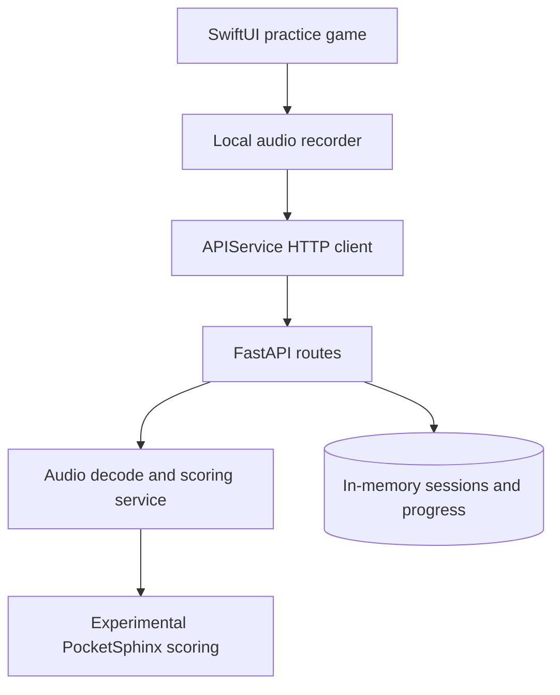

# ChatterQuest / SpeakBright

**A collaborative SwiftUI speech-practice game prototype with a separate FastAPI audio-analysis backend.**

The interface turns word practice into short monster battles, rewards and progress screens. The repository explores making practice engaging; it does not establish clinical benefit or reliable pronunciation assessment.

- SwiftUI screens implement onboarding, word practice, battles, rewards and parent views.
- GameView records audio with AVAudioRecorder and sends it to the FastAPI client; service failures are visible and scoring is labeled experimental.
- A separate Python API defines audio-analysis, session, progress and exercise routes.
- Backend scoring attempts PocketSphinx and returns an unavailable error when it cannot initialize; exercises and feedback use predefined rules and content.

**Ownership:** collaborative work by Albert Mejooli and frontend contributors visible in history. Albert's commits cover [backend implementation](https://github.com/Albert-bit07/Speech-therapy-app/commits/main/backend); frontend/game and demo contributions are shared.

**Stack:** SwiftUI/AVFoundation · FastAPI/Pydantic · librosa/NumPy · PocketSphinx · in-memory Python state · local iOS preferences.

[Setup and demo](docs/demo.md) · [Engineering details and blockers](docs/project-overview.md)

## Architecture and current integration boundary



Source-derived diagram. [GameView.swift](frontend/ChatterQuest/ChatterQuest/ChatterQuest/GameView.swift) sends recorded audio through [APIService.swift](frontend/ChatterQuest/ChatterQuest/ChatterQuest/APIService.swift); [main.py](backend/main.py) accepts multipart word/language fields and legacy query parameters. Compilation and controlled API tests do not establish a successful device-to-backend recording or valid pronunciation assessment.

## Explore the implementation

| Concern | Source |
|---|---|
| HTTP request/response models | [Backend routes](backend/main.py), [schemas](backend/models/schemas.py) |
| Audio and progress pipeline | [speech_analysis.py](backend/services/speech_analysis.py) |
| Experimental pronunciation scoring | [pronunciation_scoring.py](backend/services/pronunciation_scoring.py) |
| Rule-based feedback and exercises | [Feedback](backend/services/feedback_generator.py), [exercises](backend/services/exercise_generator.py) |
| Game and local rewards | [GameView](frontend/ChatterQuest/ChatterQuest/ChatterQuest/GameView.swift), [rewards](frontend/ChatterQuest/ChatterQuest/ChatterQuest/Rewardssystem.swift) |

## Setup

Use macOS/Xcode for iOS; the backend requirements are pinned to older packages and need a compatible Python environment (Python 3.11 is exercised by CI). From the repository root:

```bash
python3.11 -m venv .venv
# Activate the environment using your shell's activation command.
python -m pip install -r backend/requirements.txt
cd backend
python -m uvicorn main:app --host 127.0.0.1 --port 8000
```

Then inspect `/health` and `/docs`. Open `frontend/ChatterQuest/ChatterQuest/ChatterQuest.xcodeproj` in Xcode, select a simulator and configure signing/permissions as needed. Simulator and physical-device localhost differ; the API client has a local URL. CI installs the backend dependencies and runs its tests; an actual iOS/backend integration remains unverified. See [known blockers](docs/project-overview.md) before testing audio uploads.

## Demo

The original README linked [this author-provided YouTube recording](https://youtu.be/bkb0GQkSVr0). Its availability and contents were **not verified in this review**. Use the [90-second recording plan](docs/demo.md) to distinguish client integration from unvalidated scoring quality. No new product capture was created.

## Limits and verification

The backend suite has fifteen tests, with Python 3.11 CI using the declared requirements: generated WAV decoding, repeat-attempt progress, invalid audio, and multipart/query compatibility. Scoring is controlled in tests. A hosted macOS workflow builds the actual iOS simulator target in Debug and Release; its first baseline exposed missing MockAPIService references, now replaced with the existing API client. Seven controlled URLSession regression scenarios cover successful JSON, malformed JSON, empty exercises, HTTP errors and transport failures. Real pronunciation accuracy, microphone/device behavior and a full app demonstration remain unverified.

The backend has no authentication or durable database. iOS analysis uses a fixed `ios_user` and disables progress recording. iOS progress now derives counts, rewards, streaks and weekly activity from accepted session records; empty history stays empty. Audio decoding and request-format defects have regression coverage; real model output and complete game integration still need validation. No clinical dataset, train/test split, phoneme accuracy, therapy outcome or privacy-compliance validation is provided. Use synthetic/non-sensitive recordings only. Repository configuration includes a tracked `.env`; do not copy its contents into documentation or deployment settings.

## Audio/progress repair — 2026-10-20

The backend now decodes uploaded containers through a byte stream rather than interpreting encoded bytes as raw PCM. Empty/unsupported audio returns 400; uploads above 10 MiB return 413; empty phoneme results return 422. Upload handles close in a `finally` block. Progress records retain abstract phoneme scores so a second attempt can compare against the first without treating a Pydantic model as a dictionary. This does not securely erase process memory or validate pronunciation accuracy.

Run `PYTHONPATH=backend python -m unittest discover -s backend/tests -v`. Tests use an actual generated WAV and controlled scorer output. The game uses the API client; authentic phoneme scoring, persistent progress and device validation remain outstanding.

The iOS endpoint also accepts multipart `target_word`/`language` fields used by APIService.swift while retaining legacy query parameters. Missing/blank words and non-English requests are rejected. Two ASGI contract tests cover the client payload and legacy query path; these mock the analysis service and are not device or model validation. Install `httpx==0.27.2` with the declared backend requirements to run them.

## Observed session progress

`POST /api/sessions` validates the reported score and timing fields before saving. The client-supplied session ID is scoped by user: identical retries reuse the record, conflicting reuse returns 409, and retries do not increase server-side totals or repeat achievement notifications. `GET /api/progress/{user_id}` derives counts, average scores, rewards and weekly summaries from those records.

Practice dates use UTC. Multiple sessions on one day count once toward streak length; the current streak can end today or yesterday, while a longer gap resets it. Empty history returns zero counts, zero streaks and seven empty days. Sound-improvement lists remain empty until supported by real per-sound history.

These are summaries of client-reported sessions, not verified pronunciation measurements. Storage is in memory, unauthenticated user IDs are not an authorization boundary, and sessions disappear on restart. Four additional ASGI/regression tests cover empty history, real aggregates, duplicate/conflicting sessions, user isolation, calendar gaps and input rejection. No iOS device or scoring-quality validation is implied.

## Scoring availability and provenance

Backend scoring no longer substitutes randomized output when PocketSphinx is missing or cannot initialize. Analysis returns HTTP 503 and saves no progress in that case; a configured recognizer with no usable result produces no scores. Random jitter was removed from the remaining comparison heuristic. The iOS adapter returns an empty transcript/actual-sound field when none was recognized, rather than echoing the target as observed speech.

This does **not** validate the PocketSphinx scoring algorithm: decoder segmentation, phoneme alignment, acoustic-score interpretation and confidence calibration still need correction and evaluation. The Swift game calls the backend and displays unavailable errors without awarding rewards for failed requests. Tests verify unavailable/error behavior and deterministic calculations, not real pronunciation accuracy. A missing scorer now makes the backend feature explicitly unavailable instead of appearing to work with invented scores.

The decoder boundary validates finite mono 16 kHz samples, converts them to saturated signed 16-bit PCM without a WAV header, and serializes utterances on the shared decoder. Opened utterances are closed after processing errors; native decoder failures surface as unavailable service errors. Four regression tests cover exact sample bytes, invalid inputs, failure cleanup and concurrent calls with a controlled decoder. These tests do not validate phoneme recognition: `Decoder.seg()` returns word segments, and the existing comparison still requires replacement before assessment scores are trustworthy. See the [PocketSphinx API contract](https://pocketsphinx.readthedocs.io/en/stable/pocketsphinx.html).

The iOS client targets `http://localhost:8000/api` by default (Mac backend with simulator). Change `APIConfig.baseURL` for a physical-device development environment; no hosted backend is provided. Missing exercises offer retry/close controls. Recordings use the temporary directory and are removed after analysis or leaving the view; this is resource cleanup, not a secure-erasure guarantee. The UI does not claim validated speech assessment. There is no separate demo-mode implementation.
