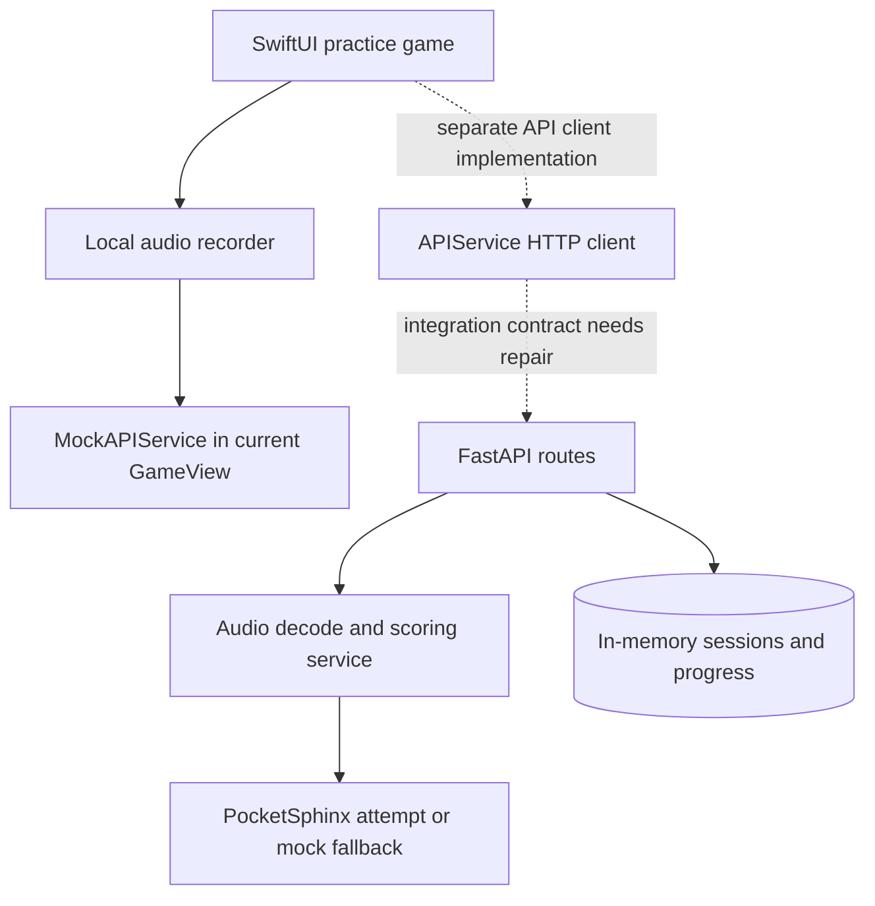

# ChatterQuest / SpeakBright

**A collaborative SwiftUI speech-practice game prototype with a separate FastAPI audio-analysis backend.**

The interface turns word practice into short monster battles, rewards and progress screens. The repository explores making practice engaging; it does not establish clinical benefit or reliable pronunciation assessment.

- SwiftUI screens implement onboarding, word practice, battles, rewards and parent views.
- GameView records audio with AVAudioRecorder, then currently calls a **mock** analysis service.
- A separate Python API defines audio-analysis, session, progress and exercise routes.
- Backend scoring attempts PocketSphinx and can fall back to randomized mock scores; exercises and feedback use predefined rules and content.

**Ownership:** collaborative work by Albert Mejooli and frontend contributors visible in history. Albert's commits cover [backend implementation](https://github.com/Albert-bit07/Speech-therapy-app/commits/main/backend); frontend/game and demo contributions are shared. This does not establish sole authorship of the entire app.

**Stack:** SwiftUI/AVFoundation · FastAPI/Pydantic · librosa/NumPy · PocketSphinx · in-memory Python state · local iOS preferences.

[Setup and demo](docs/demo.md) · [Engineering details and blockers](docs/project-overview.md) · [Recruiting notes](docs/recruiting.md)

## Architecture and current integration boundary



Source-derived diagram; dotted edges show intended integration, not a verified working path. [GameView.swift](frontend/ChatterQuest/ChatterQuest/ChatterQuest/GameView.swift) calls `MockAPIService`, despite a real [APIService.swift](frontend/ChatterQuest/ChatterQuest/ChatterQuest/APIService.swift) existing. The latter sends target word/language as multipart fields, while [main.py](backend/main.py) expects them as query parameters. End-to-end backend scoring is therefore **not** demonstrated by a successful game interaction.

## Explore the implementation

| Concern | Source |
|---|---|
| HTTP request/response models | [Backend routes](backend/main.py), [schemas](backend/models/schemas.py) |
| Audio and progress pipeline | [speech_analysis.py](backend/services/speech_analysis.py) |
| PocketSphinx and mock scoring | [pronunciation_scoring.py](backend/services/pronunciation_scoring.py) |
| Rule-based feedback and exercises | [Feedback](backend/services/feedback_generator.py), [exercises](backend/services/exercise_generator.py) |
| Game and local rewards | [GameView](frontend/ChatterQuest/ChatterQuest/ChatterQuest/GameView.swift), [rewards](frontend/ChatterQuest/ChatterQuest/ChatterQuest/Rewardssystem.swift) |

## Setup

Use macOS/Xcode for iOS; the backend requirements are pinned to older packages and need a compatible Python environment (Python 3.10 or 3.11 is a reasonable starting point, **not verified here**). From the repository root:

```bash
python3.11 -m venv .venv
# Activate the environment using your shell's activation command.
python -m pip install -r backend/requirements.txt
cd backend
python -m uvicorn main:app --host 127.0.0.1 --port 8000
```

Then inspect `/health` and `/docs`. Open `frontend/ChatterQuest/ChatterQuest/ChatterQuest.xcodeproj` in Xcode, select a simulator and configure signing/permissions as needed. Simulator and physical-device localhost differ; the API client has a local URL. These commands are a source-derived starting point, not an executed installation or working integration guarantee. See [known blockers](docs/project-overview.md) before testing audio uploads.

## Demo

The original README linked [this author-provided YouTube recording](https://youtu.be/bkb0GQkSVr0). Its availability and contents were **not verified in this review**. Use the [90-second recording plan](docs/demo.md) to distinguish game mock behavior from the independent backend pipeline. No new product capture was created.

## Limits and verification

Python AST syntax parsing passed for all seven backend files on 2026-10-20. No application tests or CI workflow were found. Runtime verification was blocked by absent FastAPI/librosa/PocketSphinx dependencies; the available Python is 3.12 while pinned NumPy 1.24.3 requires a different compatibility review. Xcode is unavailable in this Linux environment. No Swift build, audio inference, accuracy evaluation or full app demonstration was verified.

The backend has no authentication or durable database. iOS analysis uses a fixed `ios_user` and disables progress recording. Streaks and weekly histories contain placeholders. Uploaded audio handling and the client/server request contract have suspected incompatibilities detailed in the overview. No clinical dataset, train/test split, phoneme accuracy, therapy outcome or privacy-compliance validation is provided. Use synthetic/non-sensitive recordings only. Repository configuration includes a tracked `.env`; do not copy its contents into documentation or deployment settings.

## Audio/progress repair — 2026-10-20

The backend now decodes uploaded containers through a byte stream rather than interpreting encoded bytes as raw PCM. Empty/unsupported audio returns 400; uploads above 10 MiB return 413; empty phoneme results return 422. Upload handles close in a `finally` block. Progress records retain abstract phoneme scores so a second attempt can compare against the first without treating a Pydantic model as a dictionary. This does not securely erase process memory or validate pronunciation accuracy.

Run `PYTHONPATH=backend python -m unittest discover -s backend/tests -v`. Tests use an actual generated WAV and controlled scorer output. The game still uses mock analysis; iOS form/query alignment, authentic transcription/scoring, persistent progress and device validation remain outstanding.
