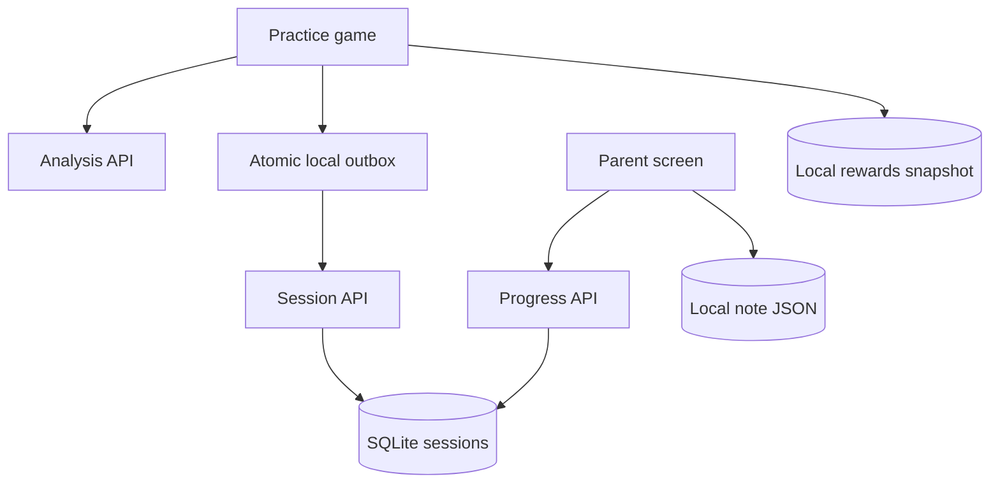

# Architecture and engineering boundaries

ChatterQuest is a SwiftUI practice prototype with a FastAPI backend. It is not a validated pronunciation assessment or a clinical product.

## Recording and recognition

`GameView` uses the real `APIService` client. It records temporary WAV audio and sends multipart audio, target word and language fields to `/api/analyze-pronunciation`. The backend also accepts legacy query parameters. Input validation and decoding are exercised by backend tests. Permission requests are tracked by a lifecycle token so a late callback cannot start recording after dismissal.

The pronunciation scorer deliberately returns an unavailable response because its earlier decoder-segment comparison did not establish phoneme assessment. It does not fabricate fallback scores. Consequently, ordinary recording cannot currently complete a scored battle against this backend. The separate `services.recognition` CLI can recognize and align English speech, but it produces no assessment score and writes no practice progress. Its native fixture tests are not a representative accuracy evaluation.

## Persistence and retry boundaries

The accepted-result path persists an attempt before applying game effects. The outbox retains a stable session ID and payload until acknowledgment. The session API transaction deduplicates identical retries and rejects changed content for the same user/session ID. SQLite stores abstract scores, identifiers, timestamps and fingerprints, not audio. HTTP integration tests use synthetic scores to exercise lost acknowledgments and restarts of both the real Swift client and FastAPI server.

The Parent screen reads server-confirmed progress for the installation identity. Failed refreshes clear the displayed result; unsynced attempts are not included. Notes use a separate bounded, atomic local JSON file. Unreadable files are preserved, failed writes leave saved state unchanged, and the editor retains its draft. Notes are not uploaded. Local reward/purchase state is independent of server progress; see [reward persistence](local-reward-storage.md).

An installation ID is not authentication. There is no account recovery, access enforcement, parental lock, multi-device synchronization or retention policy. Atomic local file replacement does not claim power-loss durability or multi-process coordination. Legacy web progress and adaptive sound history remain in memory.

## Settings and supported scope

Settings offers name editing and a word-hint playback toggle. Onboarding and word hints support English only. Unimplemented theme, voice, reminder and parental-lock controls are not presented as working features. Settings describes the actual data flow; it is not a legal privacy-policy or compliance certification.

## Verification

Backend CI runs the locked Python regression suite and dependency audit. macOS CI builds Debug and Release and executes the actual Swift client/outbox, reward, geometry, recording-permission and note-store tests. The HTTP harness tests the real client/server persistence boundary with synthetic scores.

These checks do not establish interactive device behavior, microphone/audio playback, clinical validity, model accuracy, or a formal proof. Device UI testing and a consented, appropriately licensed representative evaluation corpus remain necessary. Do not use identifiable child recordings in a public demo. Historical exposed credentials require owner rotation/review; passing tests do not establish revocation.
